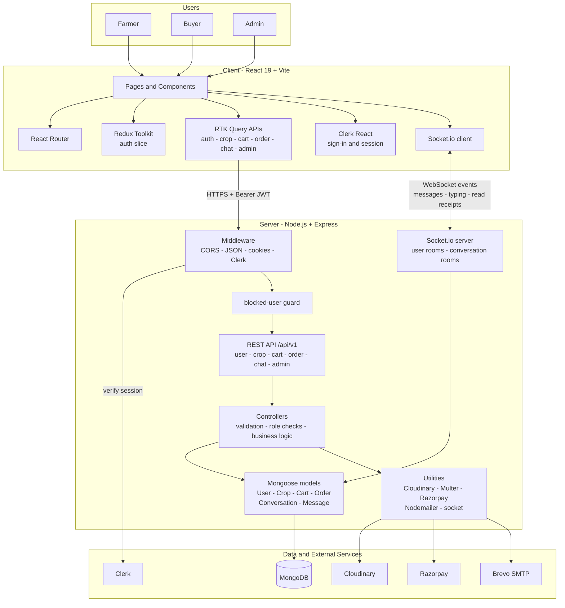

# 🌾 AgroConnect

AgroConnect is a full-stack web application that connects **farmers directly with buyers**, enabling transparent trade without middlemen.  
It provides a simple, secure, and modern platform for buying and selling agricultural products online.

---

## 🚜 Problem Statement

Farmers often struggle to reach buyers directly and sell their produce at fair prices.  
Buyers, on the other hand, face difficulty in finding reliable sources and communicating with farmers.

AgroConnect bridges this gap by offering a digital marketplace where farmers and buyers can connect, communicate, and trade securely.

---

## 💡 Solution

AgroConnect allows farmers to list their crops online while buyers can browse, chat, and place orders easily.  
The platform focuses on **direct communication, secure payments, and a smooth user experience**.

---

## ✨ Features

### 🔐 User Management
- Secure login and signup
- Role-based access for **Farmer**, **Buyer**, and **Admin**
- User profile management

### 🌾 Farmer
- Add, update, and delete crop listings
- Upload crop images
- Manage orders
- Receive notifications for new orders

### 🛒 Buyer
- Browse and search crops
- View detailed crop information
- Add items to cart
- Place orders with secure payment
- Track order history

### 💬 Chat
- Direct messaging between farmers and buyers
- Multiple conversations supported
- Chat history stored securely

### 🧑‍💼 Admin
- Manage users, crops, and orders
- Block or remove suspicious accounts or listings

### 🎨 UI & UX
- Responsive design
- Light and dark mode
- Clean and modern interface

---

## 🧱 Tech Stack

**Frontend**
- HTML,CSS,JS
- React (Vite)
- Redux Toolkit
- Tailwind CSS
- Shadcn UI

**Backend**
- Node.js
- Express.js
- MongoDB

**Other Tools**
- Razorpay (Payments)
- Socket.io (Chat)
- Cloudinary (Image Uploads)
- Clerk (Authentication)
- Nodemailer / Brevo (Email notifications)
---

## Architecture

AgroConnect uses a three-tier architecture: a React single-page client, an Express REST API, and MongoDB, with Socket.io for real-time chat and external services for authentication, payments, image storage, and email.



The Mermaid source is also available in [`architecture.mmd`](./architecture.mmd).

### Request Flow

1. **Authentication** - Clerk handles sign-in on the client. The client sends the Clerk JWT with API requests, `clerkMiddleware()` verifies it on the server, and `syncUser` maps the Clerk ID to a MongoDB `User` document with a role (`farmer`, `buyer`, or `admin`).
2. **Crop listing** - A farmer uploads a crop image through Multer. The image is stored in Cloudinary, and the crop metadata is saved in MongoDB with the farmer as `reportedBy`.
3. **Order and payment** - The buyer creates a `PENDING` order. The server creates a matching Razorpay order, and the client opens Razorpay Checkout. The server verifies the payment signature before marking the order `PAID` and `CONFIRMED`, reducing stock, updating buyer and farmer totals, and sending confirmation emails.
4. **Real-time chat** - Authenticated users join a personal room and a conversation room. Messages are persisted in MongoDB and then broadcast over Socket.io. Typing indicators, read receipts, and unread badges use the same socket connection.
5. **Admin controls** - Admin-only endpoints require a MongoDB user with the `admin` role. Admins can view users and orders and block or unblock accounts. Blocked users are rejected by `checkBlockedUser` on protected routes.

### Project Structure

```text
AgroConnect/
├── client/                 # React + Vite frontend
│   └── src/
│       ├── app/            # Redux store and root reducer
│       ├── components/     # pages, chat, and UI components
│       ├── features/       # RTK Query APIs and Redux slices
│       └── services/       # Socket.io client
├── server/                 # Express REST API
│   ├── controllers/        # business logic
│   ├── middleware/         # blocked-user guard
│   ├── models/             # Mongoose schemas
│   ├── routes/             # /api/v1 routes
│   └── utils/              # Cloudinary, Razorpay, email, socket, DB
├── architecture.mmd        # Mermaid architecture source
└── README.md
```

---

## 🚀 Why AgroConnect?

- Solves a real-world problem
- Clean and scalable architecture
- Secure and reliable transactions
- Easy to use for both farmers and buyers

---

## 👨‍💻 Contributors
- Priyanshu Sahani  

